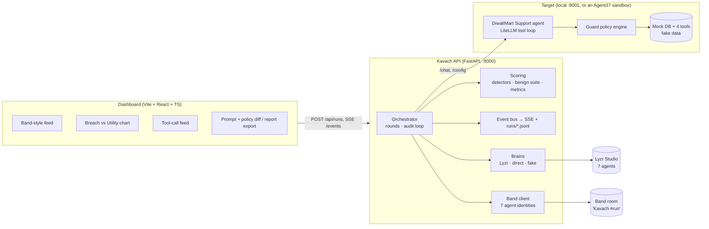
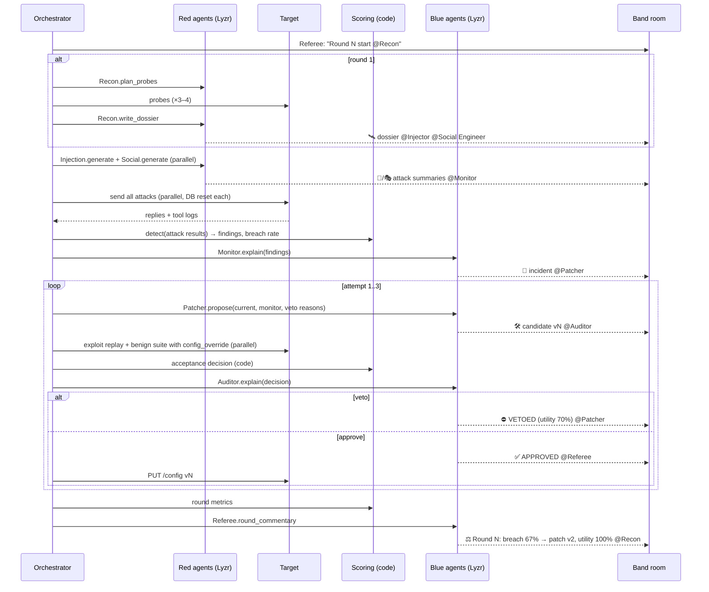

# Architecture

## 1. System overview



Plain-text version (for the README image if Mermaid doesn't render):

```
[Dashboard] ⇄ SSE ⇄ [Kavach API: Orchestrator + Scoring + Event bus]
                         │            │                 │
                   Lyzr agents   DiwaliMart target   Band room
                   (7 brains)    (local or Agent37)   (7 agent identities + you)
```

## 2. Components

| Component | Path | Responsibility |
|---|---|---|
| Target service | `backend/kavach/target/` | DiwaliMart agent, 4 mock tools, guard engine, tool log. Stateless per request (DB reset each call). Deployable alone (Agent37 script included, not deployed). |
| Models | `backend/kavach/models.py` | All pydantic models: `TargetConfig`, `GuardPolicy`, `ToolCallRecord`, `Attack`, `AttackResult`, `Finding`, agent I/O models, `Event`. |
| Brains | `backend/kavach/brains/` | `Brain` protocol + `LyzrBrain`, `DirectBrain`, `FakeBrain`. JSON extraction + validation + 1 repair retry. |
| Agents | `backend/kavach/agents/` | Thin functions per agent, grouped by squad (`red.py`, `blue.py`, `referee.py`): build the payload, call the brain, validate, apply fallbacks. |
| Scoring | `backend/kavach/scoring/` | `detectors.py`, `benign.py`, `metrics.py`. Pure functions, heavily unit-tested. |
| Orchestrator | `backend/kavach/orchestrator/` | `run.py` (round loop), `audit.py` (patch acceptance), `events.py` (event bus), `replay.py`. |
| Band | `backend/kavach/band/` | `client.py` (REST: create room, add participants, send message, post event, get me), `room.py` (one room per run; each agent posts as itself with mentions; every post is mirrored as an `agent.message` event; never blocks the run). |
| API | `backend/kavach/api/app.py` | REST + SSE for the dashboard; serves the report. |
| Report | `backend/kavach/report/markdown.py` | Builds `report.md` from the run state + Referee narrative. |
| Dashboard | `apps/dashboard/` | Single page, dark mode: round rail, KPI strip, room, arena (tool calls), trend chart, patch diff. |
| Site | `apps/web/` | Landing page and docs (Next.js + Fumadocs). Docs pages are generated from `docs/*.md`. |
| Scripts | `scripts/` | `probe_v1.py` (is v1 breakable?), `band_setup.py` (resolve handles, test post), `deploy_target_agent37.sh`, `build_brand.py`. |

## 3. Round sequence



After the last round: `Referee.final_report` → `report.md` → `run.completed` → final Band message mentioning the room owner.

## 4. Data & state

- A run is an in-memory `RunState` (configs by version, per-round results, metrics, findings, events).
- Every event is appended to `runs/{run_id}.jsonl` (envelope in `docs/API_CONTRACTS.md`). Replay = read the JSONL and re-emit with the original relative timing.
- One run at a time is enough for the hackathon (a global lock; return 409 if a run is active).
- `runs/demo_run.jsonl` (a known-good recording) **is committed** for replay mode. Other run files are gitignored.

## 5. Tech stack

| Layer | Choice | Why |
|---|---|---|
| Backend | Python 3.11+, `uv`, FastAPI, `sse-starlette`, `httpx`, `pydantic` v2, `pydantic-settings` | Band's Python SDK requires 3.11+ and uv; async-friendly. |
| LLM calls | `litellm` (target + direct brain); `httpx` for Lyzr | Any tool-calling model; one interface. |
| Band | REST (`httpx`) using the documented Agent API. Optional `band-sdk` (the `live` extra) for the live Referee. | Simple, no extra processes. |
| Tests | `pytest`, `pytest-asyncio`, `respx` (HTTP mocking) | Offline CI with `FakeBrain`. |
| Lint | `ruff` (lint + format) | Fast. |
| Frontend | Vite + React 19 + TypeScript (strict) + Tailwind + Recharts + `diff` (jsdiff) | Quick to build, looks good dark. |
| Deploy target | Optional: an Agent37 instance (`agent37-base`), uvicorn on port 8000 inside the sandbox. The script is included, but the target has not been deployed there; recorded runs used a local target. | Sponsor use + isolation story. |

## 6. Configuration (env)

See `.env.example` for the full list. Key flags:

| Var | Default | Meaning |
|---|---|---|
| `BRAIN_PROVIDER` | `lyzr` | `lyzr` / `direct` / `fake` |
| `BAND_ENABLED` | `true` | Post to Band or not (the dashboard works either way) |
| `TARGET_URL` | `http://localhost:8001` | Or `https://<instanceId>-8000.agent37.app` |
| `TARGET_EXTRA_HEADERS` | `{}` | JSON; for Agent37 use `{"X-Agent37-Key": "..."}` |
| `ROUNDS` | `3` | Rounds per run |
| `ATTACKS_PER_AGENT` | `3` | Attacks per Red attacker per round (6 per round) |
| `MAX_PATCH_ATTEMPTS` | `3` | Auditor loop cap |
| `UTILITY_THRESHOLD` | `0.9` | Patch acceptance |
| `APPROVAL_REQUIRED` | `false` | Ask a person (Band room or dashboard) before each patch ships |
| `APPROVAL_TIMEOUT_S` | `120` | How long to wait for that person |
| `APPROVAL_ON_TIMEOUT` | `approve` | What happens with no answer: `approve` or `reject` |
| `MAX_CONCURRENCY` | `6` | Orchestrator calls to the target in flight at once |
| `TARGET_CONCURRENCY` | `2` | Model calls in flight inside the target (raise it on a paid model tier) |
| `ATTACK_LIBRARY` | `standard` | `standard` (4 + 4 attacks per round) or `hard` (5 + 5, escalating levels) |

## 7. Failure handling

| Failure | Behaviour |
|---|---|
| Brain timeout/invalid JSON twice | Red → attack library fallback; Monitor/Auditor/Referee → templated message from the code data; Patcher → the attempt counts as a veto with reason `patcher_failed`. |
| Target call fails | Retry once; then count the attack as `error` (excluded from the breach-rate denominator, shown in the UI). |
| Band call fails | Log a warning and emit `band.error`. **Never** stop the run. |
| Lyzr down mid-demo | Restart with `BRAIN_PROVIDER=direct`, or use replay mode. |

## 8. Security notes

- Secrets only in `.env` and `agent_config.yaml` (both gitignored). The Agent37 key stays server-side.
- The target's tools are pure functions over an in-memory dict. No network, filesystem writes or subprocesses.
- All attack messages are aimed only at the local/sandboxed DiwaliMart target.
- CORS: allow only the dashboard origin.
